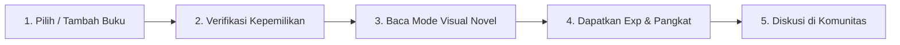

# 💎 Genmoire — Platform Adaptasi Visual Novel Kinetik untuk Buku Digital & Fisik

> **Genmoire** mengubah pengalaman membaca buku konvensional yang padat dan melelahkan menjadi **Visual Novel Kinetik yang interaktif, menenangkan, dan imersif** langsung di peramban web Anda — lengkap dengan ilustrasi latar dinamis, alunan musik ambient, penjelasan istilah kontekstual otomatis (_AI Explain_), serta sistem gamifikasi pangkat pembaca.

---

## 📖 1. Tentang Genmoire

### Apa Masalah yang Ingin Diselesaikan?

Banyak orang ingin rutin membaca buku, namun sering kali terhalang oleh:

1. **Teks yang Padat:** Lembaran novel atau buku non-fiksi yang penuh dengan teks rapat membuat mata cepat lelah dan memicu kejenuhan (_information overload_).
2. **Kehilangan Suasana Cerita:** Sulit membayangkan latar tempat atau nuansa adegan tanpa bantuan visual atau tata suara.
3. **Istilah Asing yang Membingungkan:** Berhenti membaca hanya untuk membuka kamus atau mencari arti kata di internet merusak ritme (_flow_) membaca.
4. **Kurangnya Motivasi Konsistensi:** Tidak ada pencatatan pencapaian yang menyenangkan setelah menyelesaikan sebuah bab atau buku.

### Solusi dari Genmoire:

Genmoire menghadirkan konsep **Kinetic Reading (Membaca Kinetik)**:

- Teks buku disajikan **satu paragraf per satu ketukan (_tap/click_)**, sehingga terasa ringan mengalir seperti memainkan game _Visual Novel_.
- Setiap adegan diselaraskan dengan **gambar pemandangan (_CG Artwork_)** dan **musik latar ambient (_BGM_)** yang berubah secara otomatis mengikuti alur cerita.
- Istilah atau kata yang sulit diberi penanda khusus; cukup diklik untuk memunculkan **penjelasan makna (_AI Explain_)** secara instan tanpa perlu meninggalkan halaman buku.
- Dilengkapi sistem **Pangkat Pembaca (_Tiers_)**, _streak_ harian, dan forum diskusi antar sesama pembaca.

---

## ⚙️ 2. Cara Kerja Genmoire



### Langkah 1: Memilih / Menambahkan Buku

Pengguna dapat memilih buku yang sudah tersedia di perpustakaan atau menambahkan buku baru:

- **Pencarian ISBN / Kode Buku:** Masukkan nomor ISBN 13-digit atau Smart Code buku resmi (misal: `#VN-ATOMIC-03` untuk _Atomic Habits_).
- **Zero-Upload EPUB Pribadi (BYOB):** Pengguna dapat membuka file `.epub` milik sendiri dari perangkat. File diproses **100% secara lokal di peramban Anda** tanpa pernah diunggah ke internet, sehingga privasi dan hak cipta buku terjamin aman.

### Langkah 2: Verifikasi Kepemilikan Buku (2 Cabang Bersih)

- **Cabang A (Buku Ada di Server):**
  - _Opsi 1 — Verifikasi File EPUB:_ Cocokkan berkas digital lokal secara instan.
  - _Opsi 2 — Verifikasi Buku Fisik:_ Jawab kuis tantangan kata kunci pada halaman tertentu dari buku fisik yang ada di rak Anda (misal: kata pertama di halaman 3).
- **Cabang B (Buku Belum Ada di Server):**
  - Unggah file EPUB buku Anda untuk diajukan ke tim kurator Genmoire (estimasi persetujuan dan pembuatan adaptasi visual novel maksimal 7x24 jam).

### Langkah 3: Pengalaman Membaca Kinetik (_The Kinetic Reader_)

- **Navigasi Layar Penuh:** Cukup klik layar atau tekan tombol `Spasi` / `Enter` untuk melanjutkan ke paragraf berikutnya.
- **Mode Fleksibel:** Pengguna yang ingin membaca teks murni tanpa gambar/musik dapat mengaktifkan **Mode Teks Murni (_Pure Kinetic Mode_)** kapan saja melalui panel pengaturan.
- **AI Explain In-Context:** Klik kata kunci bertanda khusus (seperti nama tempat, istilah psikologi, atau konsep filosofis) untuk membaca ringkasan penjelasannya.

### Langkah 4: Gamifikasi & Pangkat Pembaca (_Reader Tiers_)

Setiap buku yang berhasil ditamatkan akan dihitung secara otomatis untuk menaikkan peringkat pembaca dari **Tier 1 (BookTok Scroller)** hingga **Tier 5 (Loremaster)** dengan benefit voucher diskon buku dan kuota AI Explain bulanan.

---

## 3. Panduan Menjalankan Project

Aplikasi dibangun menggunakan ekosistem **Node.js modern** (Vue 3 + TypeScript + Vite + Tailwind CSS) tanpa dependensi backend rumit.

### Kebutuhan Sistem:

- **Node.js:** Versi `18.x` atau lebih baru (Sangat disarankan: **Node.js 20 LTS**).
- **Package Manager:** `npm` (bawaan Node.js).
- **Peramban Web:** Google Chrome, Microsoft Edge, Safari, atau Mozilla Firefox versi terbaru.

---

### Cara A: Menjalankan Hasil Build Produksi (Sangat Direkomendasikan ⭐)

Metode ini menjalankan bundle hasil kompilasi produksi yang telah dioptimalkan secara maksimal (_minified, tree-shaken, ultra-fast_):

```bash
# 1. Masuk ke folder project
cd genmoire-project

# 2. Pasang semua dependensi (hanya perlu sekali di awal)
npm install

# 3. Kompilasi bundle produksi
npm run build

# 4. Jalankan server preview produksi lokal
npm run preview
```

Setelah perintah di atas dijalankan, terminal akan menampilkan alamat lokal (biasanya `http://localhost:4173`). Buka alamat tersebut di peramban Anda.

---

### Cara B: Menjalankan Mode Pengembangan (_Development Server_)

Jika ingin menjalankan dalam mode _live-reload_ / _hot-module replacement_:

```bash
# 1. Pasang dependensi
npm install

# 2. Jalankan development server
npm run dev
```

Buka peramban pada alamat `http://localhost:5173`.

---

### Cara C: Menjalankan Folder `dist/` Menggunakan Static Web Server

Folder `dist/` hasil dari `npm run build` berisi berkas HTML/CSS/JS statis siap saji yang dapat dijalankan dengan server statis apapun:

```bash
# Contoh menggunakan npx serve
npx serve dist -p 3000
```

Lalu buka `http://localhost:3000`.

---

## 🛠️ 4. Teknologi yang Digunakan (_Tech Stack_)

| Layer                 | Teknologi                                           | Peran & Alasan Penggunaan                                                                        |
| --------------------- | --------------------------------------------------- | ------------------------------------------------------------------------------------------------ |
| **Framework**         | [Vue 3](https://vuejs.org/) (Composition API)       | Reaktivitas performa tinggi, modularitas komponen SFC (`<script setup>`).                        |
| **Language**          | [TypeScript](https://www.typescriptlang.org/)       | Menjamin _type-safety_, mencegah _runtime error_, lolos _build check_ 100%.                      |
| **Bundler & Tooling** | [Vite 8](https://vitejs.dev/)                       | Waktu build kilat (_lightning-fast bundling_) dan efisiensi ukuran aset statis.                  |
| **Styling**           | [Tailwind CSS 3](https://tailwindcss.com/)          | Sistem desain berbasis token kustom (warna HSL bertema hangat, tipografi, dan elevasi bayangan). |
| **Animasi**           | [GSAP](https://greensock.com/gsap/) & ScrollTrigger | Transisi mikro yang mulus (_smooth reveals, stagger entrance, pulse effects_).                   |
| **State Management**  | [Pinia](https://pinia.vuejs.org/)                   | Manajemen state reaktif untuk data buku, profil pengguna, tema, dan penjelasan istilah.          |
| **Audio & Visual FX** | HTML5 Audio API & Canvas Confetti                   | Tata suara ambient per bab dan selebrasi visual pencapaian gamifikasi.                           |

---

## 📄 8. Catatan Lisensi & Hak Cipta Aset

- Seluruh gambar ilustrasi latar (_CG Artwork_) bersumber dari koleksi domain bebas royalti (**Unsplash / Creative Commons**) yang dideklarasikan _free to use_.
- Musik latar ambient bersumber dari lisensi bebas royalti (**Pixabay Audio License**).
- Font tipografi menggunakan font web bebas lisensi dari Google Fonts (**Cinzel**, **Playfair Display**, dan **Plus Jakarta Sans**).
- Tidak ada data naskah buku berhak cipta yang diunggah atau disimpan di server eksternal; seluruh proses pembacaan file pribadi pengguna berlangsung 100% di memori lokal peramban (_Zero-Upload in-browser processing_).
